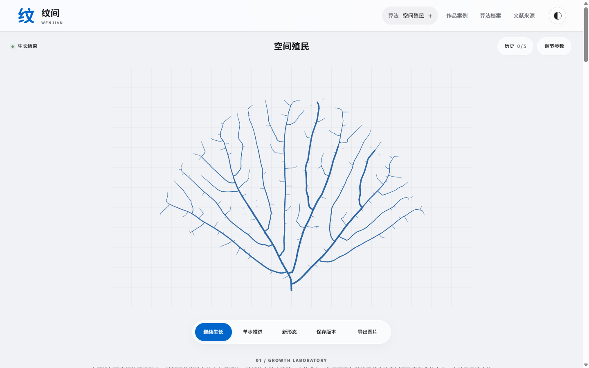
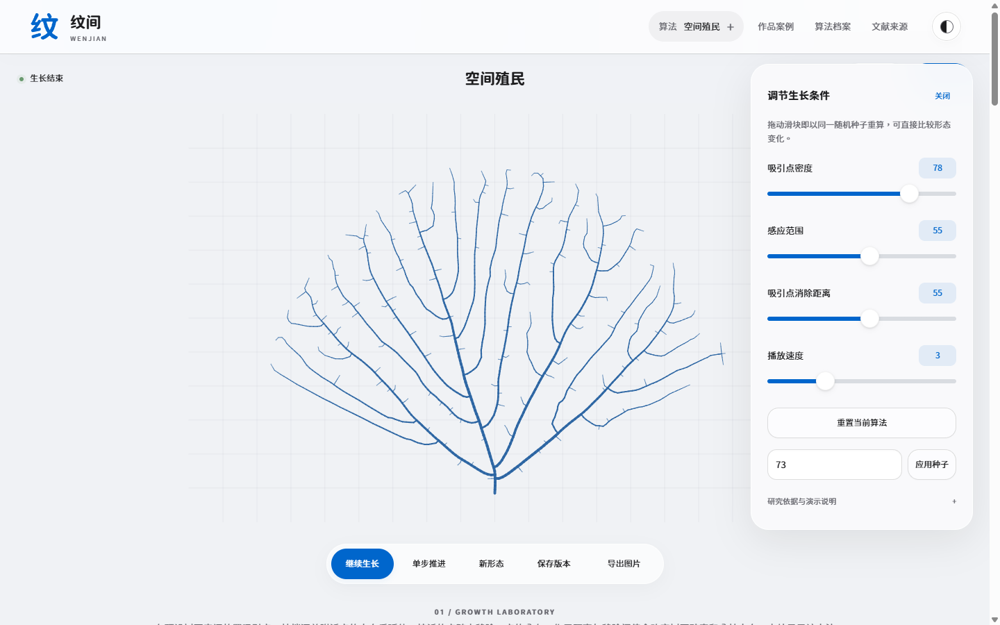
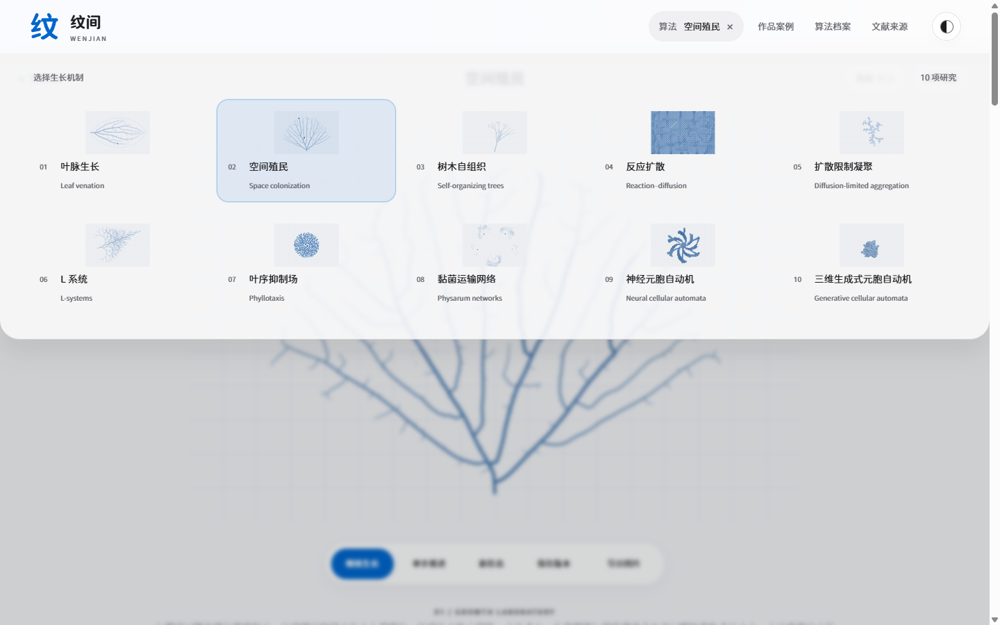

# 纹间 · WenJian

在本地观察自然生长，比较算法肌理与首饰概念。

**正式版 1.2.1 · Windows / Linux x64**

[下载发行版](https://github.com/hindingonhome/wenjian/releases/tag/v1.2.1) · [使用说明](User-Guide.md) · [使用与版权](LICENSE) · [第三方声明](THIRD_PARTY_LICENSE.txt)

CHAMBER · 个人非商业使用免费，商业使用须另行书面授权。仓库公开可见，不采用开源许可；第三方组件遵从各自许可。商业授权联系：97101yy@gmail.com。

## 软件操作界面

### 生长实验

打开即可观看当前算法的生长过程。底部操作栏支持暂停、继续、单步、切换随机形态、保存版本和导出图片。

### 参数调节

点击“调节参数”展开面板，通过滑块或数字框修改生长条件；固定随机种子可比较参数带来的形态差异。每种算法最多保留五条本次会话历史，点击缩略图可回溯。

### 算法切换

顶栏“算法”菜单提供十种生长机制。实验、首饰概念与对应研究材料会同步切换；浅深主题可随时切换。

## 下载与打开

前往 [GitHub Releases](https://github.com/hindingonhome/wenjian/releases/tag/v1.2.1)，只需下载对应平台的 ZIP。

| 平台 | 打开方式 |
| --- | --- |
| Windows x64 | 解压 Windows ZIP，运行 `WenJian-1.2.1-Windows-x64.exe` |
| Linux x64 | 解压 Linux ZIP，在该目录执行 `sh Launch.sh` |
| 备用网页版 | 在任一平台包内打开 `Backup-HTML/index.html`，保留同目录全部资源 |

每个平台包均包含应用、备用 HTML、操作说明、图片与字体资源及许可文件。`SHA256SUMS.txt` 用于校验下载包；包内 `PACKAGE-MANIFEST.sha256` 用于逐文件核对。

页面、算法、图片和字体可离线使用；外部研究链接需要联网。Windows 程序未作商业数字签名。Linux 已完成包结构和应用资源一致性校验，尚未实机验证启动兼容性。

## 简要操作

1. 在顶栏选择算法，观看生长动画。
2. 展开参数面板，拖动滑块或输入数值；速度只改变播放推进快慢。
3. 使用底部操作栏暂停、单步推进或生成新形态。
4. 点击“保存版本”，再通过“历史”恢复。历史仅保留本次会话，刷新或关闭会清空。
5. 在导出菜单中保存算法 PNG 或首饰概念 JPG。
6. 向下查看首饰概念和研究材料；拖动首饰图可切换三个预生成视角。

详细说明见 [User-Guide.md](User-Guide.md)；平台包另附 `Backup-HTML/docs/Quick-Guide.html` 图文说明书。

## 研究与图像

十种生长图是依据研究机制制作的教育演示，论文及延伸材料集中列于应用文献目录。神经元胞自动机与三维生成式元胞自动机尚未载入论文训练权重。

AI 首饰为按算法预生成的三张静态参考图，参数变化不会触发在线重绘；有限转向通过视图切换实现。PNG/JPG 不能直接用于三维打印。图像来源记录见 [概念图来源说明](docs/ai-concept-provenance.md)。

## 使用、版权与第三方许可

- 项目专有内容适用 [LICENSE](LICENSE)，商业使用须取得另行书面授权。
- 界面与“纹”字图标采用源泉圆体 GenSen Rounded，以 Noto Sans SC 回退。字体均附 SIL OFL 1.1，来源与许可见 [字体说明](docs/FONTS.md)。
- Electron、Chromium、AppImage 等第三方组件适用其各自许可，见 [第三方声明](THIRD_PARTY_LICENSE.txt) 和平台包 `Licenses` 目录。
- 研究引用不表示论文作者参与或认可本软件。第三方独立许可已授予的权利不受项目专有许可限制。

## 开发

开发依赖见 `package.json`；运行 `node --test tests/*.test.cjs` 执行回归检查。[更新记录](CHANGELOG.md) · [构建与检查记录](docs/BUILD-NOTES.md)。
